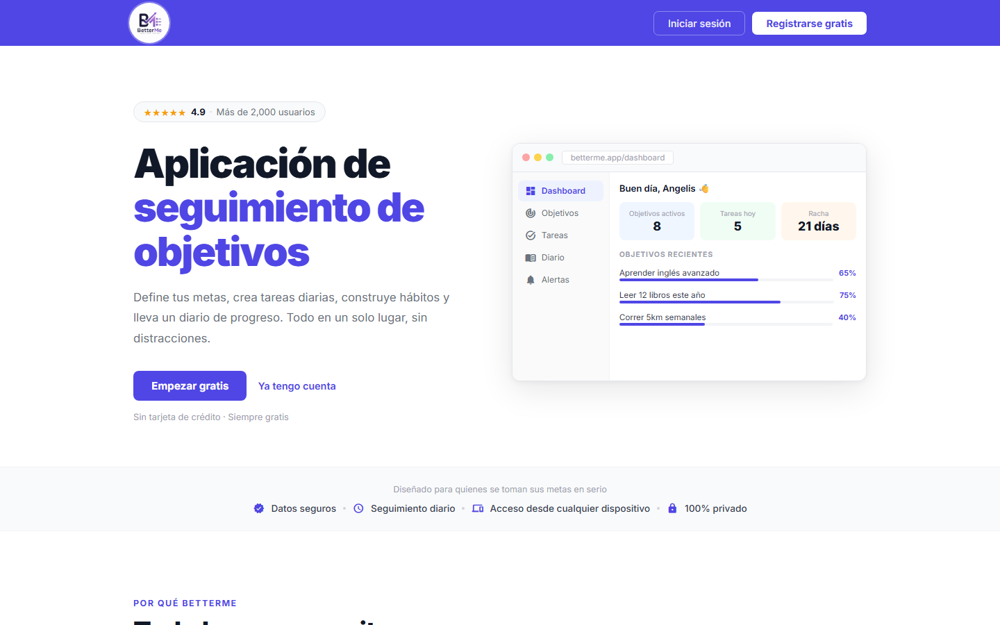
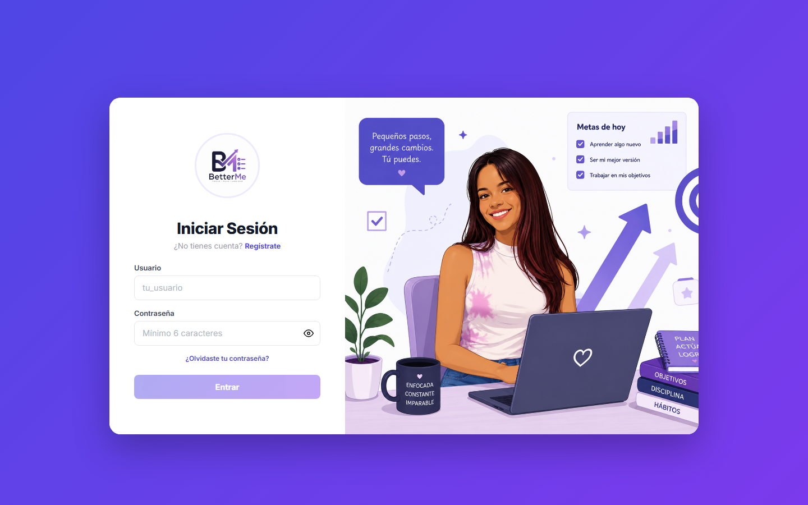

# BetterMe — Seguimiento de Objetivos

[](https://github.com/Angelismejia/SeguimientoDeObjetivos/actions/workflows/master_better-me.yml)

## 🌐 Demo en vivo

**[better-me-d6gugua2dnhucpfg.centralus-01.azurewebsites.net](https://better-me-d6gugua2dnhucpfg.centralus-01.azurewebsites.net)**

## 📖 Descripción

BetterMe es una aplicación full-stack de seguimiento de objetivos personales: permite crear metas, dividirlas en tareas, llevar un diario, ganar insignias por logros y compartir el progreso con amigos (seguidores, rachas compartidas y chat en tiempo real).

El proyecto arrancó como una app de consola en C# hecha para una asignatura en ITLA, y evolucionó a una aplicación web completa con frontend en Angular y backend en ASP.NET Core siguiendo Clean Architecture.

---

## 📸 Capturas

| Inicio | Inicio de sesión |
|---|---|
|  |  |

---

## 🚀 Funcionalidades

**Objetivos y tareas**
- Objetivos con fechas, categorías, objetivo principal y progreso automático según las tareas completadas
- Tareas con hora, prioridad y repetición (diaria, semanal, cada N semanas, mensual o anual), con historial por día
- Dashboard del día, calendario mensual y estadísticas con gráficos
- Recordatorio cuando llega la hora de una tarea (o unos minutos antes)

**Hábitos y seguimiento**
- Diario personal con entradas por día
- Racha de días consecutivos completando tareas
- Insignias que se desbloquean según el progreso

**Comunidad**
- Seguir a otras personas y ver sus objetivos públicos en un feed
- Me gusta y comentarios en los objetivos logrados de tus amigos
- Avisos cuando alguien te sigue, reacciona a tu logro o cumple un objetivo
- Rachas compartidas con amigos y chat en tiempo real (SignalR)
- Objetivos privados y opción de no aceptar seguidores

**Cuenta**
- Registro e inicio de sesión con JWT
- Recuperar la contraseña con un enlace por correo
- Foto de perfil, modo claro/oscuro, cambiar contraseña
- Exportar todos tus datos en JSON y eliminar la cuenta

---

## ✅ Calidad

- **Tests:** 98 en el backend (xUnit) y 57 en el frontend (Vitest). Además de la lógica
  de negocio, los tests de seguridad llaman a cada endpoint haciéndose pasar por otro
  usuario y exigen un 403.
- **CI/CD:** cada push a `master` compila, corre los tests y, solo si pasan, despliega a
  Azure App Service con GitHub Actions.
- **Seguridad:** secretos fuera del repo (user-secrets / variables de Azure), CSP y
  cabeceras de seguridad, límite de intentos en login, contraseñas con BCrypt, correos
  ocultos a otros usuarios, y una recuperación de contraseña que no revela qué cuentas
  existen.

---

## 🏗️ Arquitectura

**Backend — Clean Architecture (.NET 8)**

```
Backend/
├── SeguimientoDeObjetivos.Domain          # Entidades y reglas de negocio puras
├── SeguimientoDeObjetivos.Application     # Casos de uso, DTOs, interfaces de servicios
├── SeguimientoDeObjetivos.Infrastructure  # EF Core, acceso a datos, implementaciones
└── SeguimientoDeObjetivos.Api             # Controllers, SignalR hubs, autenticación JWT
```

**Frontend — Angular 21 (standalone components)**

```
Frontend/
└── src/app/
    ├── core/        # Servicios, modelos, guards, interceptors
    ├── features/    # Una carpeta por pantalla (dashboard, objectives, chat, profile, ...)
    └── shared/      # Componentes reutilizables (sidebar, barra inferior móvil, diálogos, ...)
```

---

## 🛠️ Tecnologías

**Backend**: ASP.NET Core 8, Entity Framework Core, PostgreSQL (Supabase), SignalR, JWT Bearer Auth, MailKit, xUnit

**Frontend**: Angular 21 (standalone, signals), Chart.js / ng2-charts, SignalR client, RxJS, Vitest

**Infraestructura**: Azure App Service, Supabase (PostgreSQL), GitHub Actions

---

## ▶️ Cómo correrlo localmente

### Backend

```bash
cd Backend
dotnet restore
dotnet ef database update --project SeguimientoDeObjetivos.Infrastructure --startup-project SeguimientoDeObjetivos.Api
dotnet run --project SeguimientoDeObjetivos.Api
```

Configurá la cadena de conexión a PostgreSQL antes de correr las migraciones. El secreto del JWT **no se commitea**: en local se carga con `dotnet user-secrets set "Jwt:Secret" "<valor>"`, y la app falla al arrancar si falta, en vez de caer a un default inseguro.

> Las migraciones no se aplican solas ni en el deploy ni en el CI. Si la base queda atrás respecto del modelo, todos los endpoints de esa entidad devuelven 500. Ver [OBSTACULOS.md](OBSTACULOS.md).

### Frontend

```bash
cd Frontend
npm install
npm start
```

La app queda disponible en `http://localhost:4200`. El dev server proxea `/api` y `/hubs` hacia `http://localhost:5015` (ver `Frontend/proxy.conf.json`), así que el backend tiene que estar corriendo en paralelo.

---

## 📚 Documentación

- **[OBSTACULOS.md](OBSTACULOS.md)** — los problemas reales que aparecieron construyendo
  esto y cómo se resolvieron: los IDOR que hubo que cerrar, por qué la racha se perdía
  sola, el desfase de zona horaria, y qué tener en cuenta al tocar la base en producción.

---

## 👩‍💻 Autora

Desarrollado por **Angelis Mejía Soriano**
Estudiante de Desarrollo de Software en ITLA
